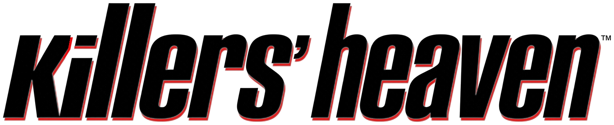

  

# DSI Recomp

**A highly work-in-progress native PC port of *Dead Space™ Ignition*, made by statically recompiling the
Xbox 360 executable.** By Killers' Heaven™.

> Unofficial fan project. Not affiliated with or endorsed by Electronic Arts, Visceral Games or Sumo Digital.
> **No game files are included.** You need your own copy of the Xbox 360 (XBLA) game.

## What it is
The game's PowerPC code is translated to native x86-64 C++ with the
[ReXGlue SDK](https://github.com/rexglue/rexglue-sdk). The SDK's Xenia-derived runtime provides
the Xbox 360 kernel, GPU (D3D12/Vulkan) and audio layers. Nothing is emulated at the CPU level: the
game runs as a normal Windows program.

## Status
| | |
|---|---|
| Boots, intro movies, title screen, menus | ✅ |
| Hardware Crack minigame | ✅ played on Windows (RTX 4070) |
| Other minigames, full playthrough, saves | 🚧 testing |
| Keyboard controls | ✅ (`--mnk_mode`) |
| Button prompts: Xbox / PlayStation / keyboard | ✅ English UI; other languages to do |
| Skip EA / Visceral logos (optional) | ✅ |
| Xbox LIVE features (leaderboards, online) | ❌ not planned |
| Setup tool and release zip | ✅ (first release being tested) |

## Features
- **Native Windows executable.** No emulator required.
- **Launcher** (`Launcher.bat`): choose Xbox 360, PlayStation 3 or keyboard button prompts, optionally skip the publisher logo movie, then play.
- **Keyboard controls:** Enter = Start, Space = A, Backspace = B, L = X, P = Y, 1/3 = LB/RB, Q/E = LT/RT, WASD = left stick, arrows = right stick.
- **PlayStation prompts** for menus, pop-ups, subtitles and the hacking minigames, drawn by DSI Recomp (the minigame ones already ship in the Xbox files). If you own the PS3 version, Setup can use its symbols instead.
- **Setup.exe**: point it at your Xbox 360 package; it extracts and checks the game and builds the prompt sets.
- **Killers' Heaven boot splash**, shown before the game's own intro.

## Getting started
**Release zip:** unzip, run `Setup.exe` and pick your Xbox 360 package (title ID `58410A7B`), then run
`Launcher.bat`. See the README.txt inside the zip.

**From source:** see **[BUILD.md](BUILD.md)**. In short:
1. `python tools\setup.py --package <your package>` (extracts, checks and prepares the game files).
2. Run `build_windows.ps1` (Visual Studio Build Tools + LLVM 20 or newer).
3. Start `Launcher.bat`.

## Repository layout
| Path | What |
|---|---|
| `port/` | ReXGlue project: manifest (function fixes, setjmp/longjmp), app code, boot splash |
| `tools/` | STFS extractor, XEX tools, texture exporter/patcher (`.stz` / `.zif` / `.zig`), button-prompt and logo-skip builders, launcher |
| `branding/` | Killers' Heaven logo |
| `docs/` | Development notes, file listing and checksums of the supported game version |
| `licenses/` | Third-party license texts |

Not in the repository, and never will be: game data, the recompiled C++ (`port/generated/`), built
executables, and anything containing the game's artwork (`mods/`, `textures/`).

## Credits
Recompilation by **Killers' Heaven**, 2026. Dead Space Ignition © 2010 Electronic Arts Inc.,
developed by Sumo Digital. Full credits, trademarks and third-party licenses: **[CREDITS.md](CREDITS.md)**.

## License
The Killers' Heaven code in this repository is under the [MIT License](LICENSE). The game, its data and
any code recompiled from it belong to Electronic Arts and are not covered.
